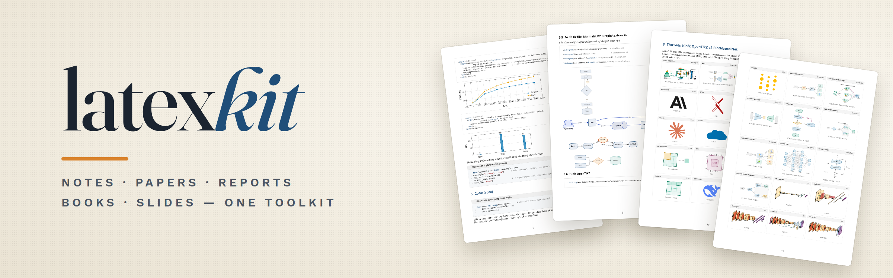
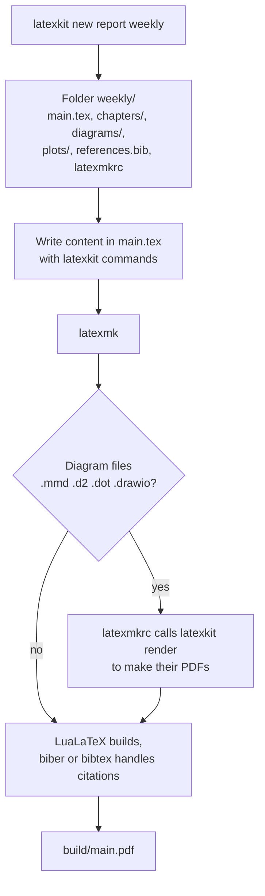

<a id="top"></a>

<p align="center"></p>

<div align="center">

**Quick LaTeX documents built on one package that every document type shares.**

[Tiếng Việt](README.md) · English

</div>

## Table of Contents

- [Overview](#overview)
- [Key Features](#key-features)
- [Repository Structure](#repository-structure)
- [Getting Started](#getting-started)
- [Usage](#usage)
- [How It Works](#how-it-works)
- [Example Workflows](#example-workflows)
- [Writing the Document](#writing-the-document)
- [Creating a New Template](#creating-a-new-template)
- [Documentation](#documentation)
- [Acknowledgments](#acknowledgments)
- [License](#license)

## Overview

latex-kit has two parts: the LaTeX package `latexkit` and the `latexkit` terminal command. The command creates a complete project folder for 11 document types, from notes, papers and reports to theses, posters, exams and CVs, in Vietnamese or English. Every document type loads the same package, so a table, diagram or code block written for notes can be copied into a report or slides unchanged. [`gallery/gallery.pdf`](gallery/gallery.pdf) shows every component next to its code.

## Key Features

- **11 document types:** notes, paper, report, book, slides, thesis, proposal, poster, exam, CV and letter. Labels, box titles, `\cref` names and theorems follow the chosen language.
- **Tables:** results tables with best values marked, full-width tables, data bars and sparklines inside cells (gradbars).
- **Diagrams:** flowcharts, pipelines, architectures and timelines in TikZ; diagrams written in Mermaid, D2, Graphviz or drawn in draw.io, turned into PDF automatically.
- **Figure library:** 73 OpenTikZ figures, 9 PlotNeuralNet network architectures and 12 paper chart recipes in the figures4papers style (comparison and ablation bars, radar, heatmap, trends), added to a project with one command.
- **Charts, code, note boxes, math, algorithms** with the same look in every document.
- **Coding-agent skill:** Claude Code and Codex use the kit the right way. When a request for a table or diagram leaves things open, the agent asks up to 3 questions to pick the right component, and never invents data.

## Repository Structure

| Path | Contents |
|---|---|
| `latexkit.py` | The `latexkit` command (Python, standard library only) |
| `tex/latexkit/` | `latexkit.sty`, 8 modules, the CV package, gradbars and the PlotNeuralNet 3D blocks |
| `templates/` | One folder per document type; `_common/` holds files every project gets |
| `assets/vendor/` | Bundled assets: OpenTikZ, PlotNeuralNet, gradbars, SciencePlots, figures4papers |
| `gallery/` | Document showing every component with its code |
| `skill/latex-kit/` | Coding-agent skill and the `reference.md` lookup sheet |

## Getting Started

Requires Python 3.8+ and TeX Live or MiKTeX with LuaLaTeX and latexmk.

1. Get the repository, then install the package, the `latexkit` command and the skill:
   ```bash
   git clone https://github.com/awun0105/latex-kit.git
   python3 latex-kit/latexkit.py install --skill
   ```
2. Check what is missing. The command lists missing engines, packages and tools, with install hints:
   ```bash
   latexkit doctor
   ```
   On Ubuntu/Debian, the recommended TeX packages are:
   ```bash
   sudo apt install texlive-luatex texlive-latex-extra texlive-pictures texlive-science \
     texlive-bibtex-extra texlive-xetex biber graphviz
   ```
3. Create a first document. Run `latexkit new` with nothing else and it asks one question at a time:
   ```bash
   latexkit new
   ```
4. Build it, then open `build/main.pdf`:
   ```bash
   cd folder-name && latexmk
   ```

## Usage

### `latexkit new`, part by part

```bash
latexkit new report weekly -t "Weekly Report" -l en -m all
#            │      │      │                  │     └─ load every module: tables, diagrams, charts, code...
#            │      │      │                  └─ labels, headings and sample text in English
#            │      │      └─ title printed on the cover
#            │      └─ name of the folder to create
#            └─ document type: multi-chapter report
```

This creates `weekly/` with `main.tex`, sample chapters, a bibliography file and the build settings. Everything after `report weekly` is optional; whatever is left out takes its default.

| Argument | Meaning | Default |
|---|---|---|
| type (1st) | Document type, see the table below | asked when missing |
| folder (2nd) | Folder to create; must not exist or must be empty | asked when missing |
| `-t "..."` | Document title | per type, e.g. "Report" |
| `-a "..."` | Author name | `git config user.name` |
| `-l vi` / `-l en` | Language of labels ("Figure", "Table"), box titles and sample text | `vi` |
| `-m ...` | Package parts to load, comma-separated; `all` loads every part, `none` loads none | per type |
| `--bib biblatex` | Use biblatex and biber instead of natbib (natbib is what many venues expect) | `natbib` |
| `--engine xelatex` | Another engine; Vietnamese needs `lualatex` or `xelatex` | `lualatex` |
| `--minted` | Highlight code with Pygments: nicer, but needs Python | off |
| `--bundle` | Copy the package into the project, for Overleaf or a machine without latexkit | off |

### Document types

| Type | Use for | Default modules |
|---|---|---|
| `notes` | Paper reading notes, study notes | table, diagram, plot, code, box, math |
| `paper` | Research paper with several authors | as `notes` |
| `report` | Multi-chapter report with summary and lists | as `notes` |
| `book` | Book or course text with an index | as `notes` |
| `slides` | Presentation (beamer) | as `notes` |
| `thesis` | Thesis: cover, declaration, Vietnamese and English abstracts, 3.5 cm left margin | as `notes` |
| `proposal` | Research proposal: objectives, Gantt plan, budget | table, diagram, plot, box |
| `poster` | A0 conference poster, three columns | table, diagram, plot, box, math |
| `exam` | Assignment or exam: points per question, grade table, answer key | table, math, code |
| `cv` | One-column CV that applicant tracking systems can read | none |
| `letter` | Cover letter or formal letter | none |

### Modules

A module is one part of the package. Loading only what a document needs keeps builds fast. To add a module after the project exists, edit the `\usepackage[...]{latexkit}` line at the top of `main.tex`.

| Module | Adds | Pick it when |
|---|---|---|
| `table` | Results tables, full-width tables, data bars in cells | the document has data tables |
| `diagram` | Flowcharts, pipelines, diagram files, figure library | it has diagrams or drawings |
| `plot` | pgfplots charts and Python charts | it has charts |
| `code` | Code blocks, terminal commands | it shows source code |
| `box` | Key-idea, warning, tip, question and summary boxes | notes, course texts |
| `math` | Theorems, definitions, `\R`, `\argmin` | it has formulas |
| `algo` | Pseudocode algorithms | it has algorithms |
| `science` | Units (`\qty{5}{\kilo\gram}`), chemical formulas (`\ce{H2O}`) | natural sciences |

### Other commands

| Command | Does |
|---|---|
| `latexkit list` | List document types and modules |
| `latexkit doctor` | Check missing engines, packages and tools |
| `latexkit build [folder]` | Run the chart scripts, then build |
| `latexkit render [file]` | Turn `.mmd`, `.d2`, `.dot`, `.drawio` diagrams into PDF |
| `latexkit plot` | Run `plots/*.py` to draw Python charts |
| `latexkit asset list [word]` | Search the figure library (`asset list plot`: figures4papers chart recipes); `asset add <id>` copies a figure or plot script into the project |
| `latexkit bundle [folder]` | Copy the package into the project, for Overleaf |
| `latexkit gallery` | Rebuild `gallery/gallery.pdf` |

## How It Works



- **Creating a project:** `latexkit new` copies the template of the chosen type, fills in title, author and language, and keeps only the sample parts of the chosen modules.
- **Shared package:** every `main.tex` starts with `\usepackage[...]{latexkit}`. The package lives in `TEXMFHOME`, so a fix in the package reaches every project on the machine.
- **Building:** the `latexmkrc` in each project picks the engine, writes the output to `build/`, and rebuilds a diagram's PDF whenever its source changes. When a diagram tool is missing, the figure shows a red notice and the document still builds.

## Example Workflows

### Example 1: a weekly report with a results table and a diagram

1. Create the project and rebuild on every save:
   ```bash
   latexkit new report week-12 -t "Week 12 Report" -l en
   cd week-12
   latexmk -pvc
   ```
2. Open `chapters/03_results.tex` and replace the sample table with real numbers:
   ```latex
   \begin{lktable}[H]{Results on the test set}{tab:results}{l cc}
     Method      & PSNR\up     & SSIM\up \\ \midrule
     NeRF        & 26.1        & 0.81 \\
     3DGS        & 27.4        & 0.86 \\
     \lkhl Ours  & \best{28.8} & \best{0.89} \\
   \end{lktable}
   ```
3. Write the architecture in `diagrams/system.d2` and insert it with `\lkdiagram{diagrams/system}`. It is rebuilt every time the `.d2` file is saved.
4. Refer to it with `\cref{tab:results}`; "Table 3.1" is written automatically.
5. Send `build/main.pdf`. Clean temporary files with `latexmk -c`.

### Example 2: working with a coding agent

With the skill installed, ask Claude Code or Codex in plain words:

> Create the week 12 report in English and add a table comparing the methods to the results chapter.

The agent creates the project with `latexkit new`, reads the existing files, and asks about what is still open: which kind of table, where the numbers come from, what to mark. It then writes the table with the matching latexkit component, builds the document and fixes errors before reporting back. The more specific the request (numbers given, "mark the best"), the fewer questions the agent needs.

### Example 3: submitting a paper to a venue

1. Write in a `paper` project as usual.
2. For the submission, switch `\documentclass` to the venue class (e.g. `IEEEtran`) and add `style=plain, margin=none, bib=none` to the `\usepackage[...]{latexkit}` line so the venue layout stays intact.
3. Run `latexkit bundle .` to copy the package into the folder, then upload the folder to Overleaf.

### Good habits

- Always create projects with `latexkit new` instead of writing a preamble by hand; templates already set language, fonts, citations and build settings.
- Use latexkit components (`lktable`, `\lkpipeline`, `keyidea`...) instead of plain LaTeX, so every document looks the same.
- Use named colors only (`accent`, `lkblue`, `lkteal`...), never hex codes in `.tex` files.
- Keep `latexmk -pvc` running while writing to see errors at once; run `latexkit doctor` for odd errors.

## Writing the Document

Each row is a common task and the command for it. Full examples of every command are in [`reference.md`](skill/latex-kit/reference.md) and [`gallery.pdf`](gallery/gallery.pdf).

| Want | Write | Module |
|---|---|---|
| Results table with best and second best marked | `\begin{lktable}{Caption}{tab:x}{l cc} ... \end{lktable}`, with `\best{28.8}`, `\second{27.4}` in cells | `table` |
| Data bar inside a table cell | `\gradbar[max=100]{72.4}`, `\gradspark{3,5,2,8}` | `table` |
| Left-to-right pipeline | `\lkpipeline{Data, Training, Evaluation}` | `diagram` |
| Flowchart with branches | `\begin{tikzpicture}[lk]` with nodes `process`, `decision`, `io` and edges `flow` | `diagram` |
| Diagram written as text or drawn in draw.io | create `diagrams/x.d2` (or `.mmd`, `.dot`, `.drawio`), then `\lkdiagram{diagrams/x}` | `diagram` |
| Library figure | `latexkit asset add nn-unet`, then `\lktikzfig{figures/nn-unet}` | `diagram` |
| Chart from a CSV file | `\begin{axis}[lkplot] \addplot table[...] {plots/x.csv}; \end{axis}` | `plot` |
| Paper comparison chart (figures4papers) | `latexkit asset add f4p-bars-comparison`, edit the numbers in `plots/f4p-bars-comparison.py`, run `latexkit plot`, then `\lkfig[1]{figures/f4p-bars-comparison}{Caption}{fig:cmp}`; in pgfplots: `\begin{axis}[lkf4pbar]` | `plot` |
| Code block | `\begin{lkcode}[Python]{Title} ... \end{lkcode}` | `code` |
| Highlight box | `\begin{keyidea} ... \end{keyidea}`, or `warning`, `tip`, `summary` | `box` |
| Existing image | `\lkfig{images/photo}{Caption}{fig:photo}` | core |

Change the look of the whole document with options in `\usepackage[...]{latexkit}`:

| Option | Effect |
|---|---|
| `accent=8B0000` | Main color (HTML code) |
| `style=plain` | Keep the class's default headings, no color |
| `float=here` | Place figures and tables exactly where written |
| `parskip` | Separate paragraphs with a blank line instead of an indent |
| `margin=2cm` | Page margins; `margin=none` keeps the class margins |

## Creating a New Template

Every folder in `templates/` with a `main.tex` is a document type. `latexkit` picks up new folders by itself; no code changes are needed.

1. Create the folder, e.g. `templates/minutes/`, and its `main.tex`:
   ```latex
   \documentclass[11pt,a4paper]{article}
   \usepackage[{{PKGOPTS}}]{latexkit}
   \title{{{TITLE}}}
   \author{{{AUTHOR}}}
   \begin{document}
   \maketitle
   \section{<<vi:Thành phần tham dự||en:Attendees>>}
   %%IF box
   \begin{summary} <<vi:Các quyết định chính.||en:Key decisions.>> \end{summary}
   %%ENDIF
   \end{document}
   ```
   - `{{TITLE}}`, `{{AUTHOR}}`, `{{DATE}}`, `{{PKGOPTS}}` are filled in when a project is created.
   - `<<vi:...||en:...>>` keeps the Vietnamese or the English part, following `-l`.
   - Text between `%%IF box` and `%%ENDIF` is kept only when the `box` module is chosen.
2. Optional: add `templates/minutes/template.json` for a description and defaults:
   ```json
   {"description": "Biên bản họp / meeting minutes", "modules": ["box"],
    "options": ["parskip"], "title": "Meeting Minutes", "minimal": true}
   ```
   `minimal: true` means the project gets only `main.tex`, `latexmkrc` and `.gitignore`, without diagram, chart or bibliography folders.
3. Test it: `latexkit list` must show the new type; run `latexkit new minutes trial -l vi`, then with `-l en` and `-m none`, build each with `latexmk` and fix every error.

## Documentation

- [`gallery/gallery.pdf`](gallery/gallery.pdf): every component with sample code, plus the whole figure library.
- [`skill/latex-kit/reference.md`](skill/latex-kit/reference.md): package options, commands and environments of each module.
- [`assets/vendor/VENDORED.md`](assets/vendor/VENDORED.md): sources, versions and local changes of the bundled assets.

## Acknowledgments

The kit bundles [OpenTikZ](https://github.com/opentikz/opentikz), [PlotNeuralNet](https://github.com/HarisIqbal88/PlotNeuralNet), [gradbars](https://github.com/Tape5try/gradbars), [SciencePlots](https://github.com/garrettj403/SciencePlots) and Chen Liu's [figures4papers](https://github.com/ChenLiu-1996/figures4papers) (palette, figure style and plotting scripts published in Nature Machine Intelligence, ICML, NeurIPS and ECCV). Diagram files use [Mermaid](https://github.com/mermaid-js/mermaid-cli), [D2](https://github.com/d2lang/d2), [Graphviz](https://graphviz.org) and [draw.io](https://github.com/jgraph/drawio-desktop). The poster template uses [tikzposter](https://ctan.org/pkg/tikzposter) and the exam template uses [exam](https://ctan.org/pkg/exam).

## License

The latex-kit code is released under the [MIT License](LICENSE). Bundled assets keep their own licenses: OpenTikZ figures are CC0 1.0; OpenTikZ code, PlotNeuralNet, gradbars and SciencePlots are MIT. Everything in `assets/vendor/figures4papers/` (including `f4p.py` and the chart recipes rewritten from the original scripts) is [CC BY-NC 4.0](assets/vendor/figures4papers/LICENSE): use and adapt it with credit, not for commercial purposes.

[Back to Top](#top)
