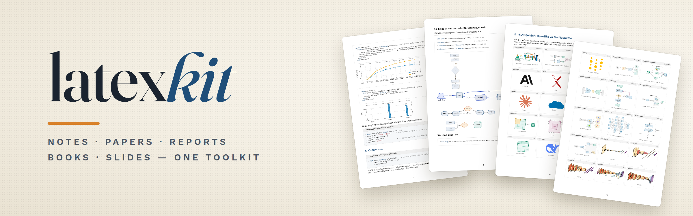

<a id="top"></a>

<p align="center"></p>

<div align="center">

**Tạo nhanh tài liệu LaTeX bằng một package dùng chung cho mọi loại tài liệu.**

Tiếng Việt · [English](README.en.md)

</div>

## Mục lục

- [Tổng quan](#tổng-quan)
- [Tính năng chính](#tính-năng-chính)
- [Cấu trúc kho mã nguồn](#cấu-trúc-kho-mã-nguồn)
- [Hướng dẫn bắt đầu](#hướng-dẫn-bắt-đầu)
- [Sử dụng nâng cao](#sử-dụng-nâng-cao)
- [Tài liệu hướng dẫn](#tài-liệu-hướng-dẫn)
- [Lời cảm ơn](#lời-cảm-ơn)
- [Bản quyền](#bản-quyền)

## Tổng quan

latex-kit gồm package LaTeX `latexkit` và lệnh `latexkit`. Lệnh tạo sẵn project cho ghi chú, paper, báo cáo, sách hoặc slide beamer, bằng tiếng Việt hoặc tiếng Anh. Mọi loại tài liệu nạp cùng một package, nên bảng, sơ đồ hay khung code viết cho ghi chú có thể chép sang báo cáo hoặc slide mà không cần sửa. Kit chạy trên Linux, macOS và Windows; mọi thành phần kèm code mẫu được trình bày trong [`gallery/gallery.pdf`](gallery/gallery.pdf).

## Tính năng chính

- **5 loại tài liệu:** `notes`, `paper`, `report`, `book`, `slides`. Nhãn, tiêu đề hộp, `\cref` và định lý đổi theo `lang=vi` hoặc `lang=en`.
- **Bảng:** `lktable`, `lktablex`, `lktblr`, các dấu `\best` và `\cmark`, ô màu theo giá trị, cùng thanh dữ liệu và sparkline của gradbars.
- **Sơ đồ:**
  - Vẽ bằng TikZ: các style flowchart và kiến trúc dùng chung, `\lkpipeline`, `\lktimeline`.
  - Viết bằng văn bản hoặc vẽ trong draw.io: Mermaid, D2, Graphviz và draw.io, được latexmk tự chuyển sang PDF.
- **Thư viện hình:** 73 hình OpenTikZ và 9 kiến trúc mạng nơ-ron của PlotNeuralNet, thêm vào project bằng một lệnh.
- **Đồ thị:** pgfplots với style `lkplot`, hoặc matplotlib dùng style SciencePlots có sẵn trong kit.
- **Code, hộp ghi chú, toán, thuật toán:** `lkcode`, `lkterminal`, `keyidea`, `warning`, `theorem`, `algorithm`, `siunitx`.
- **Skill cho coding agent:** skill `latex-kit` hướng dẫn Claude Code và Codex dùng kit. Khi yêu cầu thêm bảng, sơ đồ hay đồ thị còn thiếu thông tin, agent hỏi lại tối đa 3 câu để chọn đúng thành phần, và không tự bịa số liệu.

## Cấu trúc kho mã nguồn

| Đường dẫn | Nội dung |
|---|---|
| `latexkit.py` | Lệnh `latexkit` (Python, chỉ dùng thư viện chuẩn) |
| `tex/latexkit/` | Package `latexkit.sty`, 8 module, gradbars và các khối 3D của PlotNeuralNet |
| `templates/` | Template cho 5 loại tài liệu và các file chung trong `_common/` |
| `assets/vendor/` | Asset đóng gói kèm: OpenTikZ, PlotNeuralNet, gradbars, SciencePlots |
| `gallery/` | Tài liệu giới thiệu mọi thành phần kèm code |
| `skill/latex-kit/` | Skill cho coding agent và bảng tra cứu `reference.md` |

## Hướng dẫn bắt đầu

Cần Python 3.8 trở lên và TeX Live hoặc MiKTeX có LuaLaTeX và latexmk.

1. Tải repo về, rồi cài package, lệnh `latexkit` và skill:
   ```bash
   python3 latex-kit/latexkit.py install --skill
   ```
2. Kiểm tra máy còn thiếu gì. Lệnh liệt kê engine, package và công cụ còn thiếu, kèm cách cài:
   ```bash
   latexkit doctor
   ```
   Trên Ubuntu/Debian, các gói TeX nên có:
   ```bash
   sudo apt install texlive-luatex texlive-latex-extra texlive-pictures texlive-science \
     texlive-bibtex-extra texlive-xetex biber graphviz
   ```
3. Tạo project. Chạy `latexkit new` không kèm tham số để trả lời từng câu hỏi:
   ```bash
   latexkit new report bao-cao -t "Báo cáo tuần" -l vi -m all
   ```
4. Biên dịch. Kết quả nằm ở `bao-cao/build/main.pdf`; `latexmk -pvc` tự biên dịch lại mỗi lần lưu.
   ```bash
   cd bao-cao && latexmk
   ```

## Sử dụng nâng cao

**Thành phần thường dùng.** Danh sách đầy đủ kèm ví dụ nằm trong [`reference.md`](skill/latex-kit/reference.md).

| Cần | Viết |
|---|---|
| Bảng kết quả | `\begin{lktable}[H]{Tiêu đề}{tab:x}{l ccc} ... \end{lktable}` |
| Thanh dữ liệu trong bảng | `\gradbar[max=100]{72.4}`, `\gradspark{3,5,2}`, bảng `gradtable` |
| Flowchart, kiến trúc | `\begin{tikzpicture}[lk]` với node `process`, `decision`, `io`, `datastore` |
| Sơ đồ từ file | `diagrams/x.mmd`, `.d2`, `.dot` hoặc `.drawio`, rồi `\lkdiagram{diagrams/x}` |
| Hình trong thư viện | `latexkit asset add nn-unet`, rồi `\lktikzfig{figures/nn-unet}` |
| Đồ thị | `\begin{axis}[lkplot]`, hoặc `latexkit plot` cho `plots/*.py` |
| Code, hộp ghi chú | `lkcode`, `lkterminal`, `keyidea`, `warning`, `summary` |

**Tùy chọn của package.** `\usepackage[lang=vi, accent=8B0000, style=plain, float=here, margin=2cm]{latexkit}`. Khi nộp cho hội nghị, đổi `\documentclass` sang class của hội nghị và thêm `style=plain, margin=none, bib=none` để giữ bố cục của class.

**Công cụ cho sơ đồ (không bắt buộc).**
- Mermaid: `npm install -g @mermaid-js/mermaid-cli`.
- D2: tải từ [d2lang.com](https://d2lang.com/tour/install).
- Graphviz: cài qua `apt`, `brew` hoặc `winget`.
- draw.io: tải từ [drawio-desktop](https://github.com/jgraph/drawio-desktop/releases).

Khi thiếu công cụ, chỗ đặt hình hiện khung báo màu đỏ và tài liệu vẫn biên dịch được. Cài công cụ xong, chạy `latexkit render`.

**Các lệnh khác.**
- `latexkit asset list <từ khóa>`: tìm hình trong thư viện.
- `latexkit bundle <thư mục>`: chép package vào project, để biên dịch trên Overleaf hoặc máy khác.
- `latexkit gallery`: biên dịch lại gallery.
- `latexkit --help`: xem toàn bộ lệnh.

## Tài liệu hướng dẫn

- [`gallery/gallery.pdf`](gallery/gallery.pdf): mọi thành phần kèm code mẫu, cùng toàn bộ thư viện hình.
- [`skill/latex-kit/reference.md`](skill/latex-kit/reference.md): tùy chọn package, lệnh và môi trường của từng module.
- [`assets/vendor/VENDORED.md`](assets/vendor/VENDORED.md): nguồn, phiên bản và các chỗ đã sửa trong asset đóng gói kèm.

## Lời cảm ơn

Kit đóng gói kèm [OpenTikZ](https://github.com/opentikz/opentikz), [PlotNeuralNet](https://github.com/HarisIqbal88/PlotNeuralNet), [gradbars](https://github.com/Tape5try/gradbars) và [SciencePlots](https://github.com/garrettj403/SciencePlots). Sơ đồ từ file dùng [Mermaid](https://github.com/mermaid-js/mermaid-cli), [D2](https://github.com/d2lang/d2), [Graphviz](https://graphviz.org) và [draw.io](https://github.com/jgraph/drawio-desktop).

## Bản quyền

Code của latex-kit phát hành theo giấy phép [MIT](LICENSE). Asset đóng gói kèm giữ giấy phép gốc: hình OpenTikZ theo CC0 1.0; code OpenTikZ, PlotNeuralNet, gradbars và SciencePlots theo MIT.

[Về đầu trang](#top)
