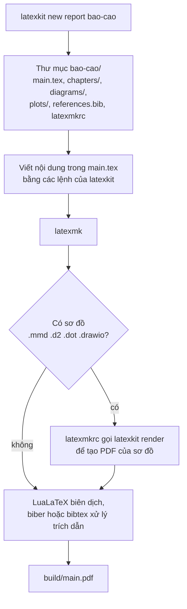

<a id="top"></a>

<p align="center"></p>

<div align="center">

**Tạo nhanh tài liệu LaTeX bằng một package dùng chung cho mọi loại tài liệu.**

Tiếng Việt · [English](README.en.md)

</div>

## Mục lục

- [Tổng quan](#tổng-quan)
- [Tính năng chính](#tính-năng-chính)
- [Cấu trúc kho mã nguồn](#cấu-trúc-kho-mã-nguồn)
- [Hướng dẫn bắt đầu](#hướng-dẫn-bắt-đầu)
- [Cách sử dụng](#cách-sử-dụng)
- [Luồng hoạt động](#luồng-hoạt-động)
- [Ví dụ quy trình làm việc](#ví-dụ-quy-trình-làm-việc)
- [Viết nội dung trong tài liệu](#viết-nội-dung-trong-tài-liệu)
- [Tạo template mới](#tạo-template-mới)
- [Tài liệu hướng dẫn](#tài-liệu-hướng-dẫn)
- [Lời cảm ơn](#lời-cảm-ơn)
- [Bản quyền](#bản-quyền)

## Tổng quan

latex-kit gồm hai phần: package LaTeX `latexkit` và lệnh `latexkit` chạy trong terminal. Lệnh tạo sẵn một thư mục project hoàn chỉnh cho 11 loại tài liệu, từ ghi chú, paper, báo cáo đến luận văn, poster, đề thi và CV, bằng tiếng Việt hoặc tiếng Anh. Mọi loại tài liệu nạp cùng một package, nên bảng, sơ đồ hay khung code viết cho ghi chú có thể chép sang báo cáo hoặc slide mà không cần sửa. Mọi thành phần kèm code mẫu được trình bày trong [`gallery/gallery.pdf`](gallery/gallery.pdf).

## Tính năng chính

- **11 loại tài liệu:** ghi chú, paper, báo cáo, sách, slide, luận văn, đề cương, poster, đề thi, CV và thư. Nhãn, tiêu đề hộp, `\cref` và định lý đổi theo ngôn ngữ đã chọn.
- **Bảng:** bảng kết quả có đánh dấu tốt nhất, bảng giãn hết chiều ngang, thanh dữ liệu và sparkline trong ô (gradbars).
- **Sơ đồ:** flowchart, pipeline, kiến trúc và mốc thời gian bằng TikZ; sơ đồ viết bằng Mermaid, D2, Graphviz hoặc vẽ trong draw.io, được tự chuyển sang PDF.
- **Thư viện hình:** 73 hình OpenTikZ và 9 kiến trúc mạng nơ-ron PlotNeuralNet, thêm vào project bằng một lệnh.
- **Đồ thị, code, hộp ghi chú, toán, thuật toán** với cùng một kiểu trình bày cho mọi tài liệu.
- **Skill cho coding agent:** Claude Code và Codex dùng kit đúng cách. Khi yêu cầu vẽ bảng hay sơ đồ còn thiếu thông tin, agent hỏi lại tối đa 3 câu để chọn đúng thành phần và không tự bịa số liệu.

## Cấu trúc kho mã nguồn

| Đường dẫn | Nội dung |
|---|---|
| `latexkit.py` | Lệnh `latexkit` (Python, chỉ dùng thư viện chuẩn) |
| `tex/latexkit/` | Package `latexkit.sty`, 8 module, gói CV, gradbars và các khối 3D của PlotNeuralNet |
| `templates/` | Mỗi thư mục là một loại tài liệu; `_common/` chứa các file mọi project đều có |
| `assets/vendor/` | Asset đóng gói kèm: OpenTikZ, PlotNeuralNet, gradbars, SciencePlots |
| `gallery/` | Tài liệu giới thiệu mọi thành phần kèm code |
| `skill/latex-kit/` | Skill cho coding agent và bảng tra cứu `reference.md` |

## Hướng dẫn bắt đầu

Cần Python 3.8 trở lên và TeX Live hoặc MiKTeX có LuaLaTeX và latexmk.

1. Tải repo về, rồi cài package, lệnh `latexkit` và skill:
   ```bash
   git clone https://github.com/awun0105/latex-kit.git
   python3 latex-kit/latexkit.py install --skill
   ```
2. Kiểm tra máy còn thiếu gì. Lệnh liệt kê engine, package và công cụ còn thiếu, kèm cách cài:
   ```bash
   latexkit doctor
   ```
   Trên Ubuntu/Debian, các gói TeX nên có:
   ```bash
   sudo apt install texlive-luatex texlive-latex-extra texlive-pictures texlive-science \
     texlive-bibtex-extra texlive-xetex biber graphviz
   ```
3. Tạo tài liệu đầu tiên. Chạy `latexkit new` không kèm gì, lệnh sẽ hỏi từng bước:
   ```bash
   latexkit new
   ```
4. Biên dịch rồi mở `build/main.pdf`:
   ```bash
   cd ten-thu-muc && latexmk
   ```

## Cách sử dụng

### Lệnh `latexkit new`, từng phần một

```bash
latexkit new report bao-cao -t "Báo cáo tuần" -l vi -m all
#            │      │       │                 │     └─ nạp mọi module: bảng, sơ đồ, đồ thị, code...
#            │      │       │                 └─ nhãn, tiêu đề và nội dung mẫu bằng tiếng Việt
#            │      │       └─ tiêu đề in trên trang bìa
#            │      └─ tên thư mục sẽ được tạo
#            └─ loại tài liệu: báo cáo nhiều chương
```

Lệnh trên tạo thư mục `bao-cao/` có sẵn `main.tex`, các chương mẫu, file tài liệu tham khảo và cấu hình biên dịch. Mọi phần sau `report bao-cao` đều không bắt buộc; phần nào bỏ trống sẽ dùng giá trị mặc định.

| Tham số | Ý nghĩa | Mặc định |
|---|---|---|
| loại (vị trí 1) | Loại tài liệu, xem bảng bên dưới | hỏi khi bỏ trống |
| thư mục (vị trí 2) | Thư mục sẽ được tạo; phải chưa tồn tại hoặc đang trống | hỏi khi bỏ trống |
| `-t "..."` | Tiêu đề tài liệu | theo loại, ví dụ "Báo cáo" |
| `-a "..."` | Tên tác giả | tên trong `git config user.name` |
| `-l vi` / `-l en` | Ngôn ngữ của nhãn ("Hình", "Bảng"), tiêu đề hộp và nội dung mẫu | `vi` |
| `-m ...` | Các phần của package cần nạp, cách nhau bằng dấu phẩy; `all` là tất cả, `none` là không phần nào | theo loại |
| `--bib biblatex` | Dùng biblatex và biber thay cho natbib (natbib là kiểu mặc định của nhiều hội nghị) | `natbib` |
| `--engine xelatex` | Engine biên dịch khác; tiếng Việt cần `lualatex` hoặc `xelatex` | `lualatex` |
| `--minted` | Tô màu code bằng Pygments, đẹp hơn nhưng cần Python | tắt |
| `--bundle` | Chép package vào project, để biên dịch trên Overleaf hoặc máy chưa cài latexkit | tắt |

### Loại tài liệu

| Loại | Dùng cho | Module mặc định |
|---|---|---|
| `notes` | Ghi chú đọc paper, ghi chú học tập | table, diagram, plot, code, box, math |
| `paper` | Bài báo khoa học, nhiều tác giả | như `notes` |
| `report` | Báo cáo nhiều chương, có tóm tắt và danh mục | như `notes` |
| `book` | Sách, giáo trình, có chỉ mục | như `notes` |
| `slides` | Slide thuyết trình (beamer) | như `notes` |
| `thesis` | Luận văn, đồ án tốt nghiệp: bìa, lời cam đoan, tóm tắt tiếng Việt và tiếng Anh, lề 3,5 cm bên trái | như `notes` |
| `proposal` | Đề cương nghiên cứu: mục tiêu, kế hoạch dạng Gantt, kinh phí | table, diagram, plot, box |
| `poster` | Poster hội nghị khổ A0, ba cột | table, diagram, plot, box, math |
| `exam` | Bài tập, đề thi: điểm từng câu, bảng điểm, bản đáp án | table, math, code |
| `cv` | CV một cột, đọc được bằng hệ thống lọc hồ sơ tự động | không |
| `letter` | Thư xin việc, thư trang trọng | không |

### Module

Module là một phần của package. Chỉ nạp phần cần dùng thì tài liệu biên dịch nhanh hơn. Muốn thêm module sau khi đã tạo project, sửa dòng `\usepackage[...]{latexkit}` ở đầu `main.tex`.

| Module | Thêm gì | Chọn khi |
|---|---|---|
| `table` | Bảng kết quả, bảng giãn ngang, thanh dữ liệu trong ô | có bảng số liệu |
| `diagram` | Flowchart, pipeline, sơ đồ từ file, thư viện hình | có sơ đồ hoặc hình vẽ |
| `plot` | Đồ thị pgfplots và đồ thị Python | có đồ thị |
| `code` | Khung code, lệnh terminal | có mã nguồn |
| `box` | Hộp ý chính, lưu ý, mẹo, câu hỏi, tóm tắt | ghi chú, giáo trình |
| `math` | Định lý, định nghĩa, ký hiệu `\R`, `\argmin` | có công thức |
| `algo` | Thuật toán dạng mã giả | có thuật toán |
| `science` | Đơn vị đo (`\qty{5}{\kilo\gram}`), công thức hóa học (`\ce{H2O}`) | khoa học tự nhiên |

### Các lệnh khác

| Lệnh | Việc làm |
|---|---|
| `latexkit list` | Liệt kê loại tài liệu và module |
| `latexkit doctor` | Kiểm tra engine, package và công cụ còn thiếu |
| `latexkit build [thư mục]` | Chạy các script vẽ đồ thị rồi biên dịch |
| `latexkit render [file]` | Chuyển sơ đồ `.mmd`, `.d2`, `.dot`, `.drawio` sang PDF |
| `latexkit plot` | Chạy `plots/*.py` để vẽ đồ thị bằng Python |
| `latexkit asset list [từ khóa]` | Tìm hình trong thư viện; `asset add <id>` chép hình vào project |
| `latexkit bundle [thư mục]` | Chép package vào project, để dùng trên Overleaf |
| `latexkit gallery` | Biên dịch lại `gallery/gallery.pdf` |

## Luồng hoạt động



- **Tạo project:** `latexkit new` chép template của loại đã chọn, điền tiêu đề, tác giả, ngôn ngữ và chỉ giữ lại các phần mẫu thuộc module đã chọn.
- **Package dùng chung:** mọi `main.tex` bắt đầu bằng `\usepackage[...]{latexkit}`. Package nằm trong `TEXMFHOME`, nên một bản sửa trong package có hiệu lực cho mọi project trên máy.
- **Biên dịch:** `latexmkrc` trong mỗi project chọn engine, đặt kết quả vào `build/`, và tự tạo PDF cho sơ đồ khi file nguồn của sơ đồ thay đổi. Khi thiếu công cụ vẽ sơ đồ, chỗ đặt hình hiện khung báo màu đỏ và tài liệu vẫn biên dịch được.

## Ví dụ quy trình làm việc

### Ví dụ 1: báo cáo tuần có bảng kết quả và sơ đồ

1. Tạo project và mở chế độ tự biên dịch lại mỗi lần lưu:
   ```bash
   latexkit new report bao-cao-tuan-12 -t "Báo cáo tuần 12" -l vi
   cd bao-cao-tuan-12
   latexmk -pvc
   ```
2. Mở `chapters/03_results.tex`, thay bảng mẫu bằng số liệu thật:
   ```latex
   \begin{lktable}[H]{Kết quả trên tập kiểm thử}{tab:ket-qua}{l cc}
     Phương pháp & PSNR\up & SSIM\up \\ \midrule
     NeRF        & 26.1        & 0.81 \\
     3DGS        & 27.4        & 0.86 \\
     \lkhl Ours  & \best{28.8} & \best{0.89} \\
   \end{lktable}
   ```
3. Viết sơ đồ kiến trúc trong `diagrams/he-thong.d2`, rồi chèn bằng `\lkdiagram{diagrams/he-thong}`. Sơ đồ được tự tạo lại mỗi lần lưu file `.d2`.
4. Tham chiếu bằng `\cref{tab:ket-qua}`; chữ "Bảng 3.1" được sinh tự động.
5. Gửi file `build/main.pdf`. Xóa file tạm bằng `latexmk -c`.

### Ví dụ 2: dùng cùng coding agent

Khi skill đã được cài, yêu cầu Claude Code hoặc Codex bằng lời thường:

> Tạo báo cáo tuần 12 bằng tiếng Việt, thêm bảng so sánh các phương pháp vào chương kết quả.

Agent tạo project bằng `latexkit new`, xem các file có sẵn, rồi hỏi lại những gì còn thiếu, ví dụ: loại bảng nào, số liệu lấy từ đâu, đánh dấu kết quả nào. Sau đó agent viết bảng bằng thành phần latexkit phù hợp, biên dịch và sửa lỗi trước khi báo xong. Yêu cầu càng cụ thể (đưa sẵn số liệu, nói rõ "đánh dấu tốt nhất") thì agent càng ít phải hỏi.

### Ví dụ 3: nộp paper cho hội nghị

1. Viết trong project `paper` như bình thường.
2. Khi nộp, đổi `\documentclass` sang class của hội nghị (ví dụ `IEEEtran`) và thêm `style=plain, margin=none, bib=none` vào dòng `\usepackage[...]{latexkit}` để giữ bố cục của hội nghị.
3. Chạy `latexkit bundle .` để chép package vào thư mục, rồi tải cả thư mục lên Overleaf.

### Thói quen nên có

- Luôn tạo project bằng `latexkit new` thay vì tự viết phần đầu file; template đã có sẵn ngôn ngữ, font, trích dẫn và cấu hình biên dịch.
- Dùng thành phần của latexkit (`lktable`, `\lkpipeline`, `keyidea`...) thay cho LaTeX thuần, để mọi tài liệu cùng một kiểu trình bày.
- Chỉ dùng màu có tên (`accent`, `lkblue`, `lkteal`...), không viết mã màu hex trong file `.tex`.
- Chạy `latexmk -pvc` khi viết để thấy lỗi ngay; khi gặp lỗi lạ, chạy `latexkit doctor`.

## Viết nội dung trong tài liệu

Mỗi dòng dưới đây là một việc thường làm và lệnh tương ứng. Ví dụ đầy đủ của từng lệnh nằm trong [`reference.md`](skill/latex-kit/reference.md) và [`gallery.pdf`](gallery/gallery.pdf).

| Muốn | Viết | Module |
|---|---|---|
| Bảng kết quả, đánh dấu tốt nhất và thứ hai | `\begin{lktable}{Tiêu đề}{tab:x}{l cc} ... \end{lktable}`, trong ô dùng `\best{28.8}`, `\second{27.4}` | `table` |
| Thanh dữ liệu ngay trong ô bảng | `\gradbar[max=100]{72.4}`, `\gradspark{3,5,2,8}` | `table` |
| Pipeline từ trái sang phải | `\lkpipeline{Dữ liệu, Huấn luyện, Đánh giá}` | `diagram` |
| Flowchart có rẽ nhánh | `\begin{tikzpicture}[lk]` với node `process`, `decision`, `io` và cạnh `flow` | `diagram` |
| Sơ đồ viết bằng văn bản hoặc vẽ trong draw.io | tạo `diagrams/x.d2` (hoặc `.mmd`, `.dot`, `.drawio`), rồi `\lkdiagram{diagrams/x}` | `diagram` |
| Hình có sẵn trong thư viện | `latexkit asset add nn-unet`, rồi `\lktikzfig{figures/nn-unet}` | `diagram` |
| Đồ thị từ file CSV | `\begin{axis}[lkplot] \addplot table[...] {plots/x.csv}; \end{axis}` | `plot` |
| Khung code | `\begin{lkcode}[Python]{Tiêu đề} ... \end{lkcode}` | `code` |
| Hộp nhấn mạnh | `\begin{keyidea} ... \end{keyidea}`, hoặc `warning`, `tip`, `summary` | `box` |
| Ảnh có sẵn | `\lkfig{images/anh}{Chú thích}{fig:anh}` | lõi |

Đổi cách trình bày cho cả tài liệu bằng tùy chọn trong `\usepackage[...]{latexkit}`:

| Tùy chọn | Tác dụng |
|---|---|
| `accent=8B0000` | Đổi màu chủ đạo (mã màu HTML) |
| `style=plain` | Giữ kiểu tiêu đề mặc định của class, không tô màu |
| `float=here` | Đặt hình và bảng đúng chỗ viết, không cho LaTeX tự dời |
| `parskip` | Tách đoạn bằng một dòng trống thay vì thụt đầu dòng |
| `margin=2cm` | Đổi lề trang; `margin=none` giữ lề của class |

## Tạo template mới

Mỗi thư mục trong `templates/` có file `main.tex` là một loại tài liệu. `latexkit` tự nhận thư mục mới, không cần sửa code.

1. Tạo thư mục, ví dụ `templates/minutes/`, và file `main.tex`:
   ```latex
   \documentclass[11pt,a4paper]{article}
   \usepackage[{{PKGOPTS}}]{latexkit}
   \title{{{TITLE}}}
   \author{{{AUTHOR}}}
   \begin{document}
   \maketitle
   \section{<<vi:Thành phần tham dự||en:Attendees>>}
   %%IF box
   \begin{summary} <<vi:Các quyết định chính.||en:Key decisions.>> \end{summary}
   %%ENDIF
   \end{document}
   ```
   - `{{TITLE}}`, `{{AUTHOR}}`, `{{DATE}}`, `{{PKGOPTS}}` được thay bằng giá trị lúc tạo project.
   - `<<vi:...||en:...>>` giữ lại phần tiếng Việt hoặc tiếng Anh theo `-l`.
   - Đoạn giữa `%%IF box` và `%%ENDIF` chỉ được giữ khi module `box` được chọn.
2. Không bắt buộc: thêm `templates/minutes/template.json` để đặt mô tả và giá trị mặc định:
   ```json
   {"description": "Biên bản họp / meeting minutes", "modules": ["box"],
    "options": ["parskip"], "title": "Biên bản họp", "minimal": true}
   ```
   `minimal: true` nghĩa là project chỉ có `main.tex`, `latexmkrc` và `.gitignore`, không có thư mục sơ đồ, đồ thị hay tài liệu tham khảo.
3. Kiểm tra: `latexkit list` phải hiện loại mới; chạy `latexkit new minutes thu-nghiem -l vi`, rồi `-l en` và `-m none`, mỗi lần biên dịch bằng `latexmk` và sửa hết lỗi.

## Tài liệu hướng dẫn

- [`gallery/gallery.pdf`](gallery/gallery.pdf): mọi thành phần kèm code mẫu, cùng toàn bộ thư viện hình.
- [`skill/latex-kit/reference.md`](skill/latex-kit/reference.md): tùy chọn package, lệnh và môi trường của từng module.
- [`assets/vendor/VENDORED.md`](assets/vendor/VENDORED.md): nguồn, phiên bản và các chỗ đã sửa trong asset đóng gói kèm.

## Lời cảm ơn

Kit đóng gói kèm [OpenTikZ](https://github.com/opentikz/opentikz), [PlotNeuralNet](https://github.com/HarisIqbal88/PlotNeuralNet), [gradbars](https://github.com/Tape5try/gradbars) và [SciencePlots](https://github.com/garrettj403/SciencePlots). Sơ đồ từ file dùng [Mermaid](https://github.com/mermaid-js/mermaid-cli), [D2](https://github.com/d2lang/d2), [Graphviz](https://graphviz.org) và [draw.io](https://github.com/jgraph/drawio-desktop). Template poster dùng [tikzposter](https://ctan.org/pkg/tikzposter), template đề thi dùng [exam](https://ctan.org/pkg/exam).

## Bản quyền

Code của latex-kit phát hành theo giấy phép [MIT](LICENSE). Asset đóng gói kèm giữ giấy phép gốc: hình OpenTikZ theo CC0 1.0; code OpenTikZ, PlotNeuralNet, gradbars và SciencePlots theo MIT.

[Về đầu trang](#top)
